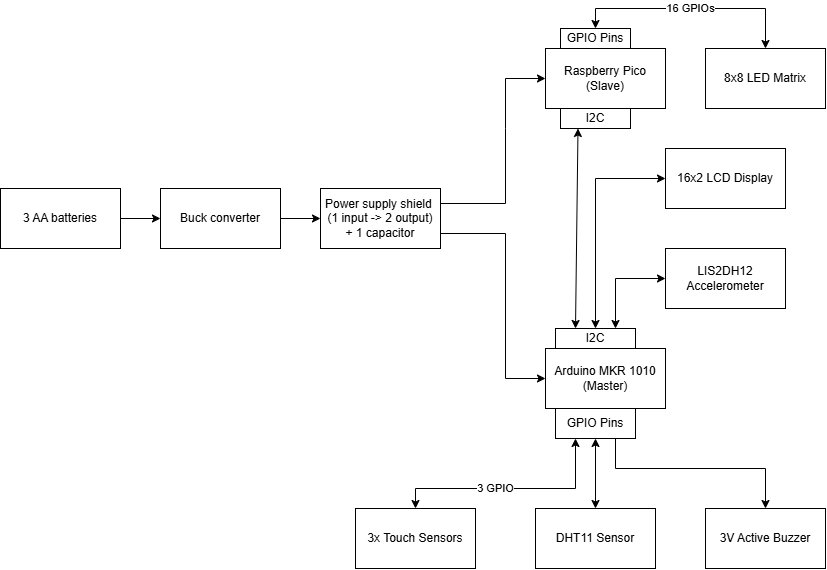
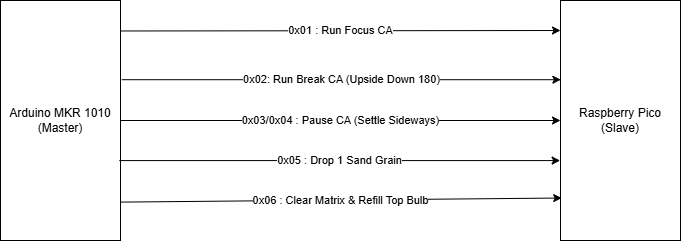
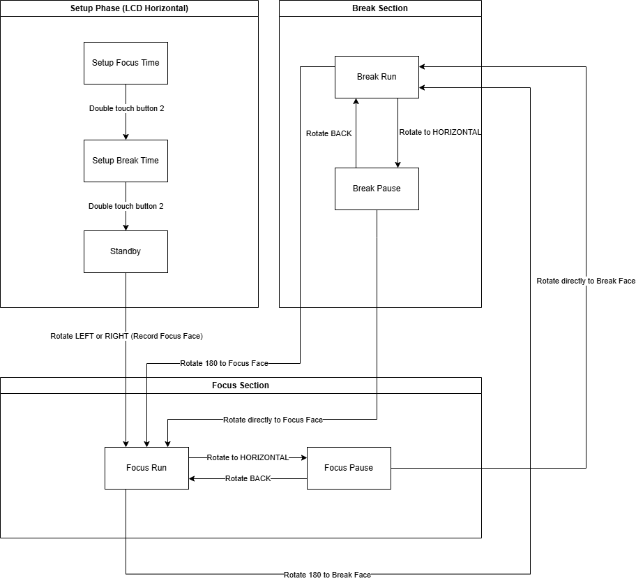
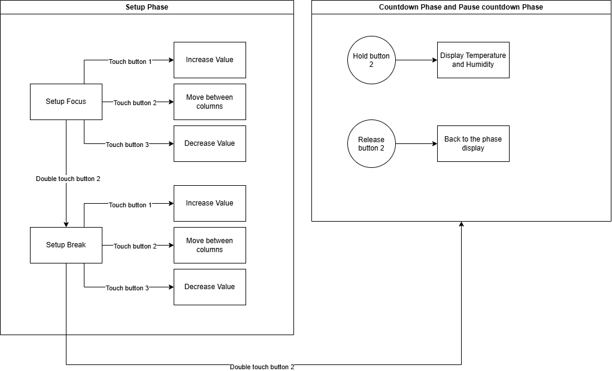

# ⏳ Pomo Pomo (Focus Cube)
> **A gravity-driven, distraction-free physical Pomodoro timer featuring a Dual-MCU architecture and real-time Cellular Automata sand physics.**

Developed as part of the *Introduction to Robotics Programming (TX00GP40-3002)* course at **Metropolia University of Applied Sciences**.

---

## 🌟 Overview
Struggling with phone distractions while studying? **Pomo Pomo** replaces screen-based timers with an intuitive, tactile cube. Users simply set their desired Focus and Break durations via capacitive touch buttons and **physically flip the cube** to start, pause, or switch modes. 

Instead of static animations, an 8x8 LED Matrix renders a virtual hourglass where sand grains fall, slide, and settle sideways in real-time based on the cube's physical orientation, powered by a custom **Cellular Automata (CA)** algorithm.

---

## 🛠️ System Architecture & Hardware

To ensure zero-latency sensor polling alongside high-frequency LED multiplexing, the system utilizes a **Master-Slave Dual-Microcontroller Architecture** communicating over **I2C**:



* **Master Controller (`Arduino MKR WiFi 1010`):**
  * Manages the core finite state machine (FSM) and countdown timers.
  * Polls 3D orientation data from the **LIS2DH12 Accelerometer** with a 500ms stability debounce filter.
  * Handles user input via **3x Capacitive Touch Sensors** (supporting single click, double click, and press-and-hold auto-increment).
  * Drives the **16x2 RGB LCD Display**, **3V Active Buzzer**, and reads ambient room conditions via a **DHT11 Temperature & Humidity Sensor**.
* **Slave Controller (`Raspberry Pi Pico`):**
  * Dedicated graphics processor listening on I2C address `0x42`.
  * Computes 2D **Cellular Automata** physics for 16 virtual sand grains across an **8x8 LED Matrix** (16 GPIOs).
* **Power System:** 3x AA Batteries stepped down via a Buck Converter and distributed through a custom power supply shield with smoothing capacitor.

---

## 📡 Custom I2C Communication Protocol

The Arduino MKR 1010 controls the Raspberry Pi Pico's physics engine by transmitting single-byte hexadecimal commands over I2C:



| Command Byte | Action / State Transition |
| :--- | :--- |
| `0x01` | **Run Focus CA:** Normal gravity orientation (0°). |
| `0x02` | **Run Break CA:** Inverted gravity orientation (180° upside down). |
| `0x03` / `0x04` | **Pause CA:** Cube placed flat; sand grains settle sideways against the glass wall. |
| `0x05` | **Drop 1 Sand Grain:** Triggered dynamically based on elapsed timer percentage (`1/16th` intervals). |
| `0x06` | **Reset Matrix:** Clears the grid and refills the top bulb with 16 sand grains. |

---

## 🔄 Finite State Machine & User Interaction

### 1. Gravity-Driven State Transitions
The system dynamically assigns the first rotated side (`SIDE_A` or `SIDE_B`) as the **Focus Face**, and the opposite 180° side as the **Break Face**:
* **Flip to Focus/Break Face:** Starts or switches the active timer immediately.
* **Lay Flat (Horizontal):** Pauses the current countdown and triggers the sideways sand-settling physics.



### 2. Capacitive Touch Controls & Temp/Humidity Overlay
* **Setup Phase:** Use Touch Buttons 1 & 3 to increase/decrease time (supports hold-to-repeat), Button 2 (Single Click) to switch between `HH:MM:SS` columns, and Button 2 (Double Click) to confirm.
* **Environmental Overlay:** Holding Button 2 for `> 0.5s` during any active/paused countdown seamlessly switches the LCD to display real-time room Temperature (°C) and Humidity (%).



---

## 📂 Repository Structure

```text
├── docs/                       # System architecture diagrams & presentation slides
├── firmware/
│   ├── mkr1010_master/         # C++ Firmware for Arduino MKR 1010 (FSM, Sensors, LCD, I2C Master)
│   └── pico_slave/             # C++ Firmware for Raspberry Pi Pico (Cellular Automata, 8x8 Matrix, I2C Slave)
└── README.md

---

👨‍💻 Author
Đặng Đức Nguyên Khoa (Will)

Bachelor of Engineering in Robotics Engineering

Metropolia University of Applied Sciences, Helsinki, Finland
